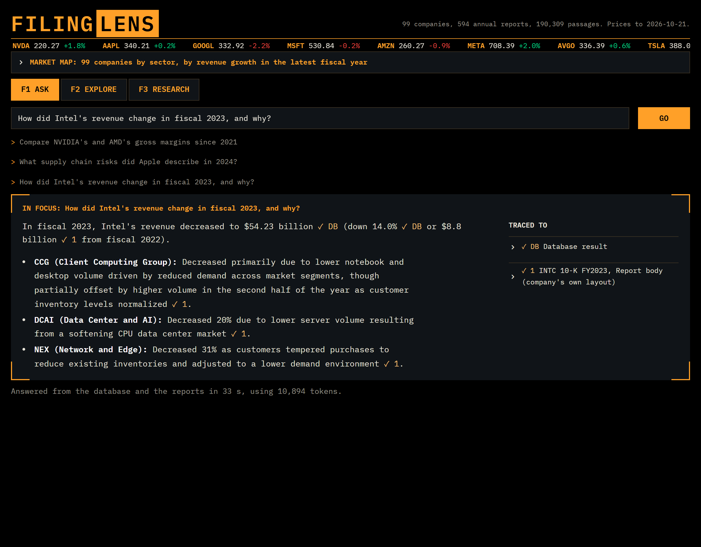
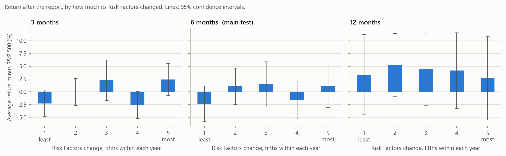

# FilingLens

Ask questions about US companies' annual reports (10-Ks) and get answers that cite the filing they came from.

Some questions need numbers ("compare NVIDIA's and AMD's gross margins since 2021"), some need the text ("what supply chain risks did Apple describe in 2024?"), and some need both ("how did Apple's R&D spending change, and why?"). FilingLens routes each question accordingly. Numbers come from SQL over a DuckDB database built from SEC XBRL data. Text comes from a search over the report passages, and the LLM answers only from the passages it was given, citing each one.

The data: 594 10-K filings from 99 large US companies (fiscal years 2020 to 2025), split into about 190,000 passages, plus their financial statements and daily stock prices. All of it is free and public: SEC EDGAR for filings and financials, Yahoo Finance for prices and sectors.

I also used the same data for a small research study and a pilot on Indian annual reports, both described below.



The web app is a trading terminal with a lens: a magnifying lens over a market map of all 99 companies, and answers framed like the view through it, with every statement ticked and traced to its source. Why it looks like this: [docs/06_web_app.md](docs/06_web_app.md).

## How it works

```
                    +----------------+
  User question --> |  Query router  |  LLM decides: needs numbers, text, or both?
                    +---+--------+---+
          numbers       |        |      "why / what / risks"
                        v        v
          +----------------+  +----------------------+
          |  Text-to-SQL   |  |  RAG over 10-Ks      |
          |  (DuckDB:      |  |  BM25 + embeddings,  |
          |  financials,   |  |  merged (hybrid),    |
          |  prices)       |  |  filter by ticker/yr |
          +-------+--------+  +----------+-----------+
                  +----------+-----------+
                             v
                Answer + chart + citations
```

Some details:

- The LLM's SQL is parsed with `sqlglot` before it runs. Only SELECT statements on known tables are allowed, and they run on a read-only connection with row and time limits. If a query fails, the error goes back to the model for one retry.
- The search combines BM25 keyword search with embeddings (bge-base) and merges the two rankings with Reciprocal Rank Fusion. The company and year in the question become filters.
- Sources are numbered in the prompt, and a citation that points to a source that doesn't exist gets flagged.
- Every financial value keeps the XBRL tag and the filing it came from, so any number can be traced back.

## Results

### Search quality

The test set is 50 questions, each with the passage(s) that answer it. An LLM drafted 49 of them from randomly chosen passages, and each was checked against its passage, with 16 edited and 1 dropped. The last one was written by hand from a failure I ran into earlier.

| Search setup | Recall@5 | MRR | Time per question |
|---|---|---|---|
| Vector only | 0.86 | 0.61 | 323 ms |
| Keyword only (BM25) | 0.90 | 0.80 | 16 ms |
| Hybrid (default) | 0.94 | 0.77 | 345 ms |
| Hybrid + reranker | 0.94 | 0.81 | 454 ms |

Hybrid is the default. Compared with vector search alone, it ranks the right passage higher on 22 questions and lower on 1 (sign test p < 0.001). The jump in Recall@5 is less certain: 4 questions gained and none lost, which with 50 questions could still be luck (p ≈ 0.13). The reranker didn't beat hybrid here, so it's optional.

Keyword search looks strong partly because the LLM-drafted questions reuse words from their passages. The write-up covers this, the ten failures I looked at, and the labelling mistakes I found along the way: [docs/05_evaluation.md](docs/05_evaluation.md).

### Answer quality

| What was measured | Result |
|---|---|
| Number answers with every expected value | 38 of 40 |
| Right figure in "what happened, and why?" answers | 20 of 20 |
| Router chose the right path | 85 of 86 |
| Cited sentences a second AI model confirmed | 96 of 105 (91%) |
| Cost per question at list price | $0.0013 |

Expected values come from the database, not from an LLM, and a different model did the grading. Text answers were all supported. Every unsupported sentence was in a mixed answer, where the model links a figure to a reason, and that's the weakest part of the system. One answer had the right figure and a wrong reason. Details, failures and the grader's own mistakes: [docs/05_evaluation.md](docs/05_evaluation.md).

### Do changes in a 10-K predict stock returns?

*Lazy Prices* (Cohen, Malloy & Nguyen, 2020) found that companies whose annual reports change a lot from one year to the next tend to do worse afterwards. I repeated the test on newer data with the test fixed in advance: 469 reports from 94 companies, fiscal years 2021 to 2025.

There was no detectable effect. How much a company changed its Risk Factors section had a correlation of +0.02 (p = 0.64) with its abnormal return over the next 6 months. A regression with year, sector, tone, momentum and size controls wasn't significant either. With 94 large companies, a small effect could still be there and go unseen.



Full results and robustness checks: [docs/04_research_findings.md](docs/04_research_findings.md).

### India pilot

Could the same approach work for NSE-listed companies, whose annual reports are PDFs with no standard layout? I tried 10 companies × 4 years. Downloading all 40 reports worked. Finding the MD&A automatically only partly did: the start and end were right in 14 of the 40, and at least the start in 26. That covered 3 of the 10 companies in every year. The next step would be to read each report's own table of contents. Details: [docs/04b_india_pilot.md](docs/04b_india_pilot.md).

## Running it

You need Python 3.10+ and a free API key for the LLM (Gemini by default; Groq or a local Ollama model also work, see `.env.example`). An NVIDIA GPU makes the embedding step much faster but isn't required.

```bash
python -m venv .venv
.venv\Scripts\activate          # macOS/Linux: source .venv/bin/activate
pip install torch --index-url https://download.pytorch.org/whl/cu130   # GPU build; skip for CPU
pip install -r requirements-full.txt
copy .env.example .env          # macOS/Linux: cp .env.example .env
```

In `.env`, put your name and email in `SEC_USER_AGENT` (the SEC requires it) and add your API key. Then:

```bash
python -m filinglens.pipeline        # download filings, financials, prices (~2 GB, 30-60 min the first time)
python -m filinglens.parse_reports   # reports -> sections -> passages
python -m filinglens.build_index     # embeddings + keyword index

python -m filinglens.ask "What supply chain risks did Apple describe in 2024?"
python -m filinglens.ask "Compare NVIDIA's and AMD's gross margins since 2021"
python -m filinglens.ask "How did Apple's R&D spending change since 2021, and why?"

python -m streamlit run app.py --server.address localhost   # the web app, at http://localhost:8501

python -m filinglens.research.build         # the research study
python -m filinglens.evaluation.search_eval # the search results table above
pytest
```

The pipeline takes `--tickers AAPL NVDA` to download just a few companies, `--skip-documents` for numbers only, and `--refresh` to pick up newly published reports. The company list is in [config/companies.yaml](config/companies.yaml).

## Database

Everything lives in one DuckDB file, `data/processed/filinglens.duckdb` (the embeddings are in ChromaDB next to it):

| Table | One row per | Main columns |
|---|---|---|
| `companies`, `company_info` | company | ticker, CIK, name, sector, industry |
| `filings` | 10-K | ticker, fiscal_year, filing_date, document_url |
| `financials` | company, year, metric | value, unit, xbrl_tag, accession_number |
| `financials_wide` (view) | company, year | revenue, net_income, ..., gross_margin, revenue_growth |
| `prices` | company, trading day | adjusted close, volume |
| `sections`, `chunks` | 10-K section / passage | ticker, fiscal_year, item ('1A', '7', ...), text |
| `text_change`, `tone`, `future_returns`, `topic_mentions` | report | the research study's measures |

## Code layout

```
filinglens/
  ingest/       SEC and Yahoo Finance downloaders (rate-limited, cached)
  text/         10-K HTML -> clean text -> sections (Items) -> passages
  rag/          embeddings, ChromaDB, BM25, hybrid merge, reranker, cited answers
  sql/          schema description, text-to-SQL, safety checks
  evaluation/   test questions and search measurement
  research/     the Lazy Prices study
  india/        NSE downloader and PDF -> MD&A extraction
  router.py, assistant.py, combine.py, charts.py, ask.py
app.py          the web app (app.css, app.js and .streamlit/ for its look)
online/         compact data for the free online version
eval/           test questions and per-question results
notebooks/      the research study's statistics and charts
docs/           one write-up per step: what was built, why, and what went wrong
tests/          offline tests on SEC-shaped sample data
```

## What's next

- When the database can't answer a question, fall back to the reports instead of stopping.
- Make mixed answers quote their reasons, so an explanation can be checked word for word.
- Fix earnings per share across stock splits ([details](docs/06_web_app.md#the-data-bug-found-along-the-way)).

## Docs

1. [Data pipeline](docs/01_data_pipeline.md)
2. [Reading the reports and RAG](docs/02_rag.md)
3. [Text-to-SQL, the router and charts](docs/03_text_to_sql.md)
4. [Research study](docs/04_research_findings.md) and the [India pilot](docs/04b_india_pilot.md)
5. [Measuring and improving the search](docs/05_evaluation.md)
6. [The web app](docs/06_web_app.md)

The [project guide](docs/00_project_guide.md) has the full plan.
