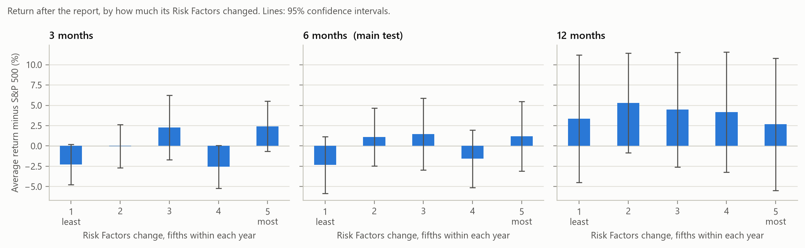
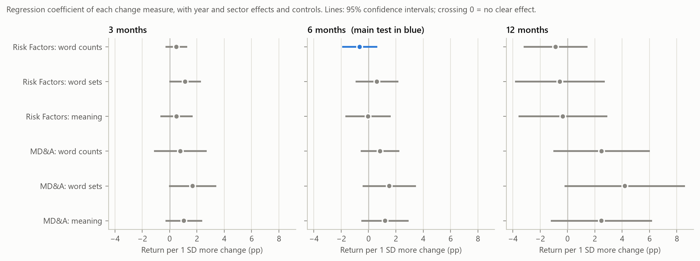
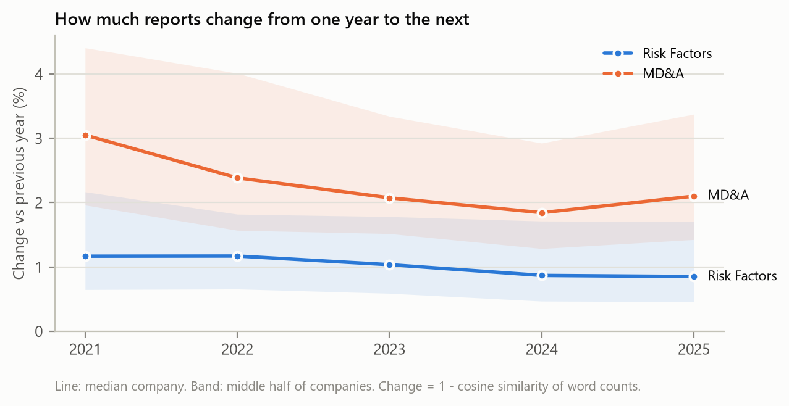
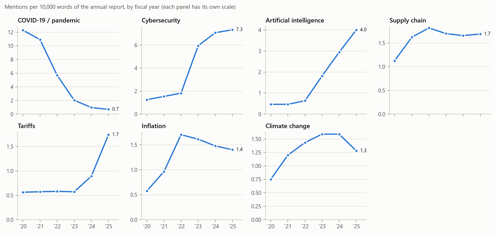

# Step 4: does a change in the annual report predict the stock return?

**Goal:** answer a real research question with data, the way a quant researcher would: state a hypothesis, fix the test in advance, build the measures, check them, run the statistics and report what came out, including "no clear effect".

**The question:** companies whose annual report changes a lot from last year: do their shares do worse afterwards? This is the finding of the finance paper **"Lazy Prices"** (Cohen, Malloy & Nguyen, *Journal of Finance*, 2020), repeated here at small scale on newer data.

**Commands** (from the project folder, in this order):

```
.\.venv\Scripts\python.exe -m filinglens.research.pick_companies   # suggests companies to add (already done)
.\.venv\Scripts\python.exe -m filinglens.pipeline                  # 99 companies: reports, numbers, prices, sectors
.\.venv\Scripts\python.exe -m filinglens.parse_reports             # reports -> sections and chunks
.\.venv\Scripts\python.exe -m filinglens.research.build            # change scores, tone, returns, topics
```

Then open `notebooks/04_research_study.ipynb` for the statistics and charts. The charts are also saved in `docs/images/`.

---

## Results

**Short answer: no detectable effect.** Among 94 large US companies in fiscal years 2021–2025, how much a company changed its Risk Factors did not predict how its shares did over the next 6 months.

| Main test, fixed in advance | Result |
| --- | --- |
| Sample | 469 reports from 94 companies (fiscal years 2021–2025) |
| Spearman correlation: Risk Factors change vs. 6-month abnormal return | **+0.02** (p = 0.64) |
| Most-changed fifth minus least-changed fifth | **+3.5 points** (95% CI −2.1 to +9.1, p = 0.21); Lazy Prices predicts a negative number |
| Regression with year and sector effects, tone, momentum and size | **−0.65 points** per 1 SD more change (95% CI −1.94 to +0.64, p = 0.33; n = 430, the reports that also have a tone score) |
| The same without one artefact report (Williams 2024, see "Findings" 8) | −0.23 points (95% CI −1.85 to +1.39, p = 0.78) |
| All 18 combinations (3 measures × 2 sections × 3 horizons) | **0 of 18** with p < 0.05 (0 after the Holm correction) |



If Lazy Prices held here, the bars would fall from left (least changed) to right (most changed). They don't: the groups bounce around zero and every confidence interval overlaps the others.



The main test (blue) has the paper's sign, but it is small and its interval comfortably includes zero. The other 17 combinations scatter on both sides of zero, mostly slightly positive: no hidden pattern the main test missed.

**What this does and doesn't show.** It doesn't prove the effect is gone. Lazy Prices reported a long-short difference of up to 1.88% a month in its strongest version, roughly 11 points over six months. For our comparison (most-changed minus least-changed fifth) that would mean about −11 points, and our 95% interval runs from −2.1 to +9.1, so an effect that large would very likely have shown up. A smaller effect, a few points, can't be ruled out with 469 reports. (The comparison is rough: the paper used monthly-rebalanced portfolios and a different risk adjustment.) Plausible reasons for not finding it: the effect may have weakened since publication, as published anomalies often do (McLean & Pontiff, 2016); large, heavily followed companies are where investors are *least* likely to miss a change; and five years is a short sample.

**How to say it in an interview:** *"The main estimate had the paper's sign but was small and not significant; it shrank by two-thirds when I removed one report whose 'change' was a format artefact, and none of 18 variations was significant. With this sample I can rule out an effect as large as the paper's, but not a small one."*

### Other results

- **Companies really are lazy about rewriting.** The median company changed about **1%** of its Risk Factors (word counts) per year, falling from 1.2% in fiscal 2021 to 0.9% in 2024–25, and about 2–3% of its MD&A. The paper's premise holds.

  

- **The three measures agree, but not perfectly.** Rank correlations: word counts vs word sets 0.84, word counts vs meaning 0.72, word sets vs meaning 0.80. A change in *length* barely relates to any of them (0.08–0.16), so they measure content, not size.
- **Tone, an exploratory observation.** In the full regression, a more positive MD&A tone went with a *lower* 6-month return: −2.5 points per standard deviation (p = 0.006), with the same sign in all five years (strongest in fiscal 2024). It was a control, not a test chosen in advance, so it is a lead to test on new data, not a finding. It fits research on "tone management" (Huang, Teoh & Zhang, 2014), where unusually upbeat wording precedes weaker results. Tone itself followed the economy: the median MD&A was neutral for fiscal 2020 (COVID) and mildly positive since.
- **Topic trends.** "Artificial intelligence" went from about a quarter of reports (fiscal 2020–22) to **98%** in fiscal 2025, and from 0.5 to 4.0 mentions per 10,000 words. Cybersecurity mentions jump in fiscal 2023, when a new SEC rule required a cybersecurity section (Item 1C): text measures react to rules, not only to events. Tariffs rise in 2024–25; COVID fades.

  

- **Survivorship bias, and a benchmark effect.** Over 12 months the *average* company beat the S&P 500 by 4.0 points, but the *median* company was only 0.8 points ahead and lagged it in fiscal 2022 and 2023. Picking today's large companies pushes returns up; comparing an equal-weighted set of 99 companies with a size-weighted index, during years when a handful of giant tech stocks drove the index, pushes them down. The main test compares companies within the same year, so both mostly cancel out there.

---

## Key terms

| Term | Meaning |
| --- | --- |
| **Abnormal return** | The stock's return minus the market's (SPY, an S&P 500 fund) over exactly the same days. It removes what moved all stocks together. |
| **Look-ahead bias** | Using information that wasn't public yet at the time. The classic backtest mistake: it makes any strategy look brilliant. |
| **Survivorship bias** | Studying only the companies that are still around (or big) today. They are the ones that did well, so the past looks better than it was. |
| **Cosine similarity** | Two texts as vectors of word counts; the cosine of the angle between them. 1 = same word mix, 0 = no words in common. |
| **Jaccard similarity** | Words used in both texts ÷ words used in either. Ignores how often a word appears; reacts to new vocabulary. |
| **Embedding similarity** | Similarity of meaning: texts turned into vectors by a language model, so a reworded paragraph still matches. |
| **FinBERT** | A BERT language model trained further on financial text. Rates a sentence positive, negative or neutral the way an analyst would. |
| **Quintiles** | Five equal-sized groups after sorting, here by change score within each year: group 1 changed least, group 5 most. |
| **p-value** | If there were no effect at all, how often would a result at least this strong appear by chance? Small = hard to explain as chance. It is **not** the probability that the hypothesis is true. |
| **95% confidence interval** | A range that, computed this way on many samples, would contain the true value 95% of the time. If it includes 0, "no effect" is plausible. |
| **Fixed effects** | Giving each year (or sector) its own baseline in a regression, so the comparison is between companies in the same year and sector. |
| **Clustered standard errors** | Uncertainty computed so that the same company's different years count as related, not as independent evidence. Without it, results look more certain than they are. |
| **Multiple testing** | Running many tests makes some look significant by chance (about 1 in 20 at the 5% level). The **Holm correction** raises the p-values to account for how many tests were run. |
| **Pre-specified test** | Deciding the main test before seeing any results, so the result can't be chosen after the fact. |

---

## Is this new research?

No, and it's better to say so. Lazy Prices has been replicated, and 10-K similarity with embeddings and FinBERT-based tone have both been studied before. What this project adds is a small, honest **out-of-sample check**:

- **Newer years:** the paper used 1995–2014; this uses fiscal years 2021–2025. Published stock-market patterns often weaken once people know about them: McLean & Pontiff (2016) found returns of published anomalies fall by about 58% after publication. So "does it still work?" is a fair question.
- **Three measures side by side** (word counts, word sets, meaning) on the same reports, with the main test fixed in advance.
- **Measurement pitfalls found and documented** (see "Findings while building it"), which is most of the real work in text-based research.

Interview version: *"I replicated a known result on new data, with a pre-specified test, and reported what I found."* That is what a research team does with any new idea before trusting it.

---

## The data

- **99 companies**, the largest US-listed ones in each of Yahoo Finance's 11 sectors (9 per sector), that file a 10-K for every fiscal year from 2020 to 2025. Chosen by a rule (`research/pick_companies.py`), not by hand, so the choice can't favour the hypothesis. Foreign companies (TSMC, ASML) file a different form (20-F) and recent listings don't have six years of reports, so they're excluded.
- **Change scores** need two consecutive years, so they exist for fiscal years 2021–2025.
- **Returns** come from daily prices adjusted for splits and dividends (Yahoo Finance).
- **Sectors and industries** come from Yahoo Finance too (new `company_info` table). These are labels only; every financial number still comes from SEC.

| | Reports | Companies |
| --- | --- | --- |
| 10-K reports downloaded (fiscal 2020–2025) | 594 | 99 |
| Risk Factors found (at least 500 words) | 563 | 94 |
| **Risk Factors change scores** (fiscal 2021–2025, each vs the year before) | **469** | **94** |
| MD&A change scores | 434 | 87 |
| MD&A tone scores (237,963 sentences) | 521 | 87 |
| 6-month returns for the scored reports | 469 | 94 |
| 12-month returns (complete windows only: fiscal 2025 reports are too recent) | 383 | 94 |

Why 94 and 87, not 99: see "Findings while building it", point 6.

---

## How each part works

### 4.1 Text change (`research/text_change.py`)

For each company, the Risk Factors (Item 1A) and MD&A (Item 7) are compared with the same section one year earlier, in three ways. Each gives a similarity from 0 to 1, and **change = 1 − similarity**.

| Measure | What it compares | Reacts to | Ignores |
| --- | --- | --- | --- |
| **Word counts (cosine)** — the main measure, as in the paper | how often each word appears | a long new risk, a section rewritten | rewording a few sentences |
| **Word sets (Jaccard)** — also in the paper | which words appear at all | new vocabulary ("tariff", "pandemic") | how often a word is used |
| **Meaning (embeddings)** — our addition | each ~300-word chunk vs its closest chunk the other year (both directions) | a genuinely new topic | a paragraph reworded with the same meaning |

Before any returns were looked at, the word measures were cleaned:

- **Letters only, no numbers.** Every MD&A updates its figures and years ("2024" → "2025"). That's routine, not a change in what the report says.
- **No stop words** ("the", "of", "and"). They are the most common words in any text; with them in, any two reports look about 99.7% alike and the score barely varies.
- **Not the company's own name** (see "Findings while building it").
- **Sections under 500 words are skipped**: they are usually a one-line pointer to another part of the report, not the section itself.

### 4.2 Tone (`research/tone.py`)

FinBERT (`ProsusAI/finbert`, ~440 MB, runs on the GPU) scores every sentence of the MD&A. **Tone = average of P(positive) − P(negative)**, from −1 to +1. Table rows and fragments are skipped, because they're numbers, not language. Why a finance-specific model: a general sentiment model reads "liabilities", "tax" and "risk" as negative, but in a 10-K they're neutral; "costs decreased" is good news.

Why the MD&A and not Risk Factors: the MD&A is management's own account of the year. Risk Factors is negative by design, so its tone says little.

### 4.3 Future returns (`research/returns.py`)

For each 10-K: the stock's return over the next **3, 6 and 12 months** (63, 126, 252 trading days) minus SPY's over the same days. Two rules against look-ahead bias:

1. The holding period starts at the close of the **first trading day after** the filing date. Many 10-Ks are published after the market closes, so the filing day's own close may not "know" the report yet.
2. A window is used only when it is **complete**. A report filed four months ago has a 3-month return but no 6-month return yet (not a partial one).

Also measured: the abnormal return over the 12 months **before** the filing (momentum), as a control.

### 4.4 Statistics (`research/analysis.py`)

The main test, fixed before looking at results (`analysis.PRIMARY`): **Risk Factors change (word counts) vs. the 6-month abnormal return.** Three views of it, from simplest to most careful:

1. **Correlation**, Pearson (straight line, sensitive to extreme values) and Spearman (ranks only).
2. **Quintiles, as in the paper:** each year, five equal groups by change score; most-changed minus least-changed average return, with Welch's t-test. Groups are formed **within each year** because some years changed every report (COVID in 2020–21); ranking across all years would compare years, not companies.
3. **Regression** with year and sector fixed effects, controls for MD&A tone, momentum and company size (log total assets), all inputs standardized, standard errors clustered by company.

Then all 18 combinations (3 measures × 2 sections × 3 horizons) as a robustness check, with the Holm correction for multiple testing.

### 4.5 Topic trends (`research/topics.py`)

How often each report mentions artificial intelligence, cybersecurity, supply chains, tariffs, inflation, COVID-19 and climate change, per 10,000 words and as the share of reports mentioning each topic at least once. The patterns are regular expressions written to avoid false hits: "AI" must be capitals and its own word (so "said" doesn't count), "climate" only counts as "climate change/related" (not "the economic climate"), and the Inflation Reduction Act doesn't count as inflation.

---

## Findings while building it

Most of the work in a text study is making the measures right. These make good answers to _"Tell me about a problem you found in your data"_:

1. **A company's own name was the "biggest change" of all.** JPMorgan started writing its name as one word, "JPMorganChase", in fiscal 2024. Two of its most frequent words vanished and a new one appeared, so its Risk Factors looked like the most-changed report in the sample, although the risks themselves barely moved. Found by reading the top of the "most changed" list *before* looking at any returns. Fix: the word measures ignore every name the company used during the study period (from SEC's records, including former names such as Facebook → Meta), and the words run together. **Lesson:** always look at the extremes of a new measure; they are where artefacts show up.
2. **Stop words make every report look the same.** With "the", "of", "and" left in, any two 10-Ks are about 99.7% similar by word counts, and the score hardly varies between companies. Numbers and years ("2024" → "2025") would count as changes too. Both are removed before comparing.
3. **A parser rule that was right for 14 companies was wrong for Bank of America.** Its MD&A heading line reads "Item 7. Bank of America Corporation and Subsidiaries", with the title on the next line. The rule "a title on the next line only counts if the heading line is otherwise empty" (written to skip bare "Item 7" page headers) rejected it, so its MD&A was a 38-word table-of-contents entry. Before changing Step 2's parser, the new rule was run on all 594 saved reports and every difference was checked: 19 reports changed and all got better (Bank of America's MD&A went from 38 to ~47,000 words; Enterprise Products' MD&A no longer runs on into Item 7A; PepsiCo's exhibit list moved from "Item 16" to Item 15). **Lesson:** measure a fix on the whole dataset, not only on the case that prompted it.
4. **Financial data tags that looked complete weren't.** The first 14 companies (mostly tech) all used the same XBRL tags. With 85 more, net income was missing for 17 companies (Caterpillar, Mastercard and Booking never tag `NetIncomeLoss` in their 10-K) and revenue for three banks and a utility. Fallback tags were added at the end of each list; a check against a copy of the database confirmed that **none of the 6,331 existing values changed** and 97 gaps were filled. (Details in `docs/01_data_pipeline.md`.)
5. **The same ticker, a different company.** `VMRK` is Vivmark Residential, the former Equity Residential (SEC company ID 906107). Yahoo Finance's profile for it named a different apartment landlord, but the price history matched Equity Residential's. Cross-checking identifiers between sources is part of the job. And `XOM` now belongs to a new holding company with no 10-K history, so ExxonMobil isn't in the sample.
6. **Some reports can't be measured, and that's reported, not hidden.** Five companies write their 10-K in their own layout, with plain headings like "Risk Factors" and the Item numbers only in an index at the back (GE, Intel, McDonald's, Morgan Stanley) or in a separate exhibit file (Wells Fargo). They have no Risk Factors score and drop out of the main test. Twelve companies have no measurable MD&A in any year (it's in an attached annual report, or under a heading without an Item number), plus ConocoPhillips in 2020, so they have no tone score. Enbridge reports its numbers in Canadian dollars, so it has no total assets in our USD-only financial data.
7. **Fixing the test before seeing results.** The main test (`analysis.PRIMARY`) was written into the code before any return was computed. The robustness chart shows all 18 combinations, so a reader can see whether the main result is typical or a lucky cell.
8. **Two more artefacts, found after the results, and why the measure stayed as it was.** Reading the top of the "most changed" list again with all 99 companies:
   - **Williams 2024** (the biggest change of all): from fiscal 2024 Williams files one combined 10-K with its pipeline subsidiaries, so "transco" (0 → 294 mentions) and "nwp" (0 → 293) appeared. A new report format, not new risks.
   - **Deere 2023:** it rewrote "John Deere" and "the Company" as "we" ("john" 259 → 5). The name filter uses SEC's name, "Deere & Co", which has no "John".
   - **Union Pacific 2025** was real: its Norfolk Southern merger added a block of merger risks.

   These were found *after* the returns had been computed, so the measure was **not** changed: redefining a measure after seeing the results is the same mistake as picking the best test afterwards. Instead, a sensitivity check reports the main result without them. Deere has no tone score, so it was never in the full regression, and leaving out **one report** (Williams 2024) moved the coefficient from −0.65 to −0.23. **Lesson:** a weak estimate can hinge on a single extreme point, so always check influential observations; and decide cleaning rules before the outcome is known (for a rerun: also drop the names of subsidiaries that file in the same 10-K, and brand names).
9. **The embedding measure has a noise floor.** Caterpillar's 2025 Risk Factors repeat 2024's almost word for word (word-count change 0.00001), yet the embedding change is 0.017. A few changed line breaks shifted where the ~300-word chunks start and end, so 10 of 36 chunks differ slightly. Layout alone produces changes of about 0.01–0.02 on this measure; comparing paragraphs instead of fixed-size chunks would reduce it.

---

## Limitations

*To write yourself, in your own words (project guide, Step 4 checklist). Questions to cover:*

- *Who is in the sample, and who is missing? What does that do to the results (survivorship bias, section 7 of the notebook)?*
- *How many data points, how many years, and how much does one unusual year (2022's bear market, 2025's tariffs) weigh?*
- *What the change measures can and can't see (a moved paragraph, a rewritten but equivalent risk, a new law that changed every report).*
- *What the abnormal return leaves out (risk differences between companies, e.g. a utility vs a chip maker).*
- *Correlation vs causation: even a strong result wouldn't say that changing the report* causes *the return.*

---

## Exercises (to learn the code)

1. **Read the extremes.** In the notebook's section 2, pick the most-changed report and open both years' text in `data/processed/text/<TICKER>/`. Is the change real (a merger, a new business) or an artefact? This is how the JPMorgan problem was found.
2. **Break the main test on purpose.** Change `analysis.PRIMARY` to the measure and horizon that looks best in the robustness chart and re-run. Notice how easy it would be to report that one. Then change it back: that's why it was fixed in advance.
3. **Look-ahead bias by hand.** In `returns.py`, make the window start on the filing day itself (`side="left"`). Re-run `--only returns` and the notebook. Does anything change? Why could it matter more for small companies with news-moving reports?
4. **Add a topic.** Add a pattern for "interest rates" or "GLP-1" to `topics.TOPICS`, write a test for a false hit it must avoid, and re-run `--only topics`.
5. **Equal-weight vs value-weight.** The group averages give every company the same weight. How would weighting by company size change the question being asked?
6. **Recover a missing company.** Open `data/processed/text/MCD/` and find where Risk Factors starts (a plain "RISK FACTORS" heading, with the Item number only in an index at the back). Sketch a rule that finds such headings without breaking the 594 reports that already work, and test it on all of them first, the way the Bank of America fix was tested.
7. **Test the tone lead properly.** Write down, *before* running anything, one test of "more positive tone → lower return" (measure, horizon, controls). Which data could you run it on that this study hasn't used (earlier years, other companies)? Why can't you test it on the same 469 reports where you noticed it?

## Interview questions you can now answer

- **What is look-ahead bias, and how did you avoid it?** Using information that wasn't available at the time. Returns start at the close of the first trading day after the filing date, windows are used only when complete, and today's market value (in `company_info`) is never used for past years.
- **What is survivorship bias?** Studying only today's survivors makes the past look better. My 99 companies are today's largest. Over 12 months the average one beat the S&P 500 by 4 points, but the median one barely did, because the index itself was driven by a few giant tech stocks: two effects pushing in opposite directions. The main test compares companies within the same year, which removes most of that tilt, but the results only describe large, successful companies.
- **Your result wasn't significant. Is that a failure?** No. The test was fixed in advance, the measures were checked, and the answer is "no detectable effect in this sample", with a confidence interval that rules out an effect as large as the original paper's. Publishing only positive results is how false findings spread. I can also say what would change my mind: a larger sample, more years, smaller companies.
- **What would you do differently?** Fix more cleaning rules before computing returns (subsidiary and brand names), compare paragraphs rather than fixed-size chunks for the embedding measure, and use a size-matched or equal-weighted benchmark next to SPY.
- **What does a p-value mean?** The probability of a result at least this strong if there were no effect. It isn't the probability that the hypothesis is true, and 0.05 is a convention, not a law.
- **Why fix the main test in advance?** With 18 combinations, about one would look significant by chance. Choosing the best-looking one afterwards (p-hacking) produces "findings" that don't replicate.
- **Why cluster standard errors by company?** The same company's years are related (same business, same writing team), so they aren't independent evidence. Treating them as independent overstates certainty.
- **Why three similarity measures?** Each sees a different kind of change: word counts see proportions, word sets see new vocabulary, embeddings see meaning. If a result shows up in only one, it's fragile.
- **What would you do with 10× more data?** All ~4,000 US 10-K filers over 20 years: enough to test smaller effects, split by industry and company size, and check whether the effect weakened after the paper came out. The pipeline already handles any list of tickers; the limits are SEC's rate limit (10 requests a second) and GPU time for the embeddings.
