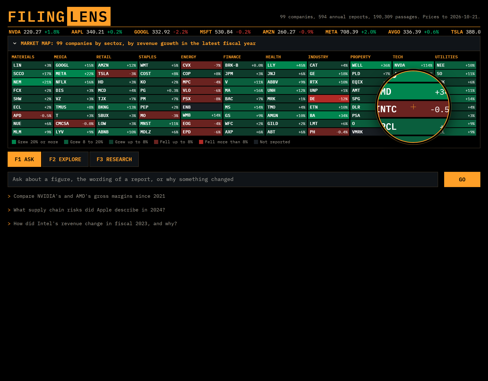

# Step 6: the web app

**The question:** can a stranger use FilingLens without a terminal window, and can they see at a glance why an answer can be trusted?

**To run it on your laptop:** `python -m streamlit run app.py --server.address localhost`, then open http://localhost:8501. The `--server.address` part keeps it on this computer: without it, anyone on the same Wi-Fi could spend the API tokens.



**What was built:**

| Part | File | What it does |
| --- | --- | --- |
| The app | `app.py` | Three tabs: Ask, Explore, Research. It only displays results; all the work stays in `filinglens/assistant.py`, so the app and the `ask` command can't disagree |
| The look | `.streamlit/config.toml`, `app.css` | Colours and font, then the shapes a theme can't do |
| The lens and keys | `app.js` | The magnifying lens and the function keys |
| Fonts | `static/fonts/` | IBM Plex Mono, kept in the project so the app needs no outside font service |
| Online version | `filinglens/online.py`, `online/` | The same app with a lighter search, small enough for a free host |
| Tests | `tests/test_app.py`, `tests/test_online.py` | Run the real app on a small database with a fake LLM |

---

## The design, and why it looks like this

The app is a **trading terminal with a lens**, because the name is FilingLens: filings are what it reads, and a lens is what it does.

- **The terminal.** Black screen, amber labels, one monospaced font, green and red for up and down, and a tape of real closing prices across the top. It says "finance" before you read a word, and it packs a lot of data onto one screen, which is how analysts like to work.
- **The market map.** Your 99 companies turned out to be 11 sectors of exactly 9 each, which makes a perfect grid. Each square is coloured by revenue growth in the latest fiscal year, with the figure printed in it, so colour isn't the only signal (red and green are hard to tell apart for some people). It answers "which companies can I ask about?" without a list. Clicking a square starts a question about that company. It folds away once you've asked something, so the answer stays near the top.
- **The lens.** Move the mouse over the map and a magnifying lens enlarges what's under it. This is the one memorable thing, and it's the name of the product made literal. `app.js` copies the map into a circle and scales the copy. Clicks pass straight through it.
- **The viewfinder.** An answer is framed with camera corners, and its question is labelled IN FOCUS.
- **Ticks.** `[DB]` and `[1]` become ticks (✓ DB, ✓ 1), and TRACED TO in the margin lists what each one points to. Auditors tick a figure once they have traced it to a source, and that's what citations do.
- **Function keys.** F1, F2 and F3 really switch tabs, and GO is what a terminal's enter key says.
- **Financial conventions.** Explore prints losses in brackets and missing values as a dash, as a financial statement does.

**Earlier versions, and why they went.** The first looked like every other Streamlit app. The second was a pale "editorial" page with a serif title, tidy but forgettable. The third was a green auditor's desk: better, but still too quiet. The lesson was to stop decorating and start from what the product is.

## Decisions worth explaining

**No FastAPI.** The plan had a separate API. Streamlit can call the Assistant directly, and nothing else needs an API yet, so it would only add code. If a phone app or another service ever needs the answers, that's when to add one.

**One Assistant for everyone.** Loading the models takes seconds, so the app loads them once (`st.cache_resource`) and all visitors share them. The database connection can only do one thing at a time, so a lock makes visitors take turns. That's fine for a demo and wouldn't be for thousands of users.

**Earnings per share isn't in Explore.** The data has a real problem here (see below), and a chart would draw it as a crash that never happened.

**Dollars and tildes in answers.** Streamlit's Markdown treats `$...$` as a maths formula and `~...~` as a strikethrough, so "$54 billion to $60 billion" would come out as garbled maths. The app escapes both before showing any answer or report text.

**HTML from the LLM is never rendered.** Only the map, the header and the tape are shown as HTML, and they're built from database values with company names escaped.

## What went wrong

- **A crash only tests could find.** Two charts shared one internal name, so the page crashed as soon as Ask and Explore both showed a chart. A test caught it before anyone saw it.
- **My checks misled me, three times.** A screenshot script reported "no errors" while its clicks on the tabs had silently failed. A video check showed the same frame nine times because the test web server can't jump inside a file. And dim screenshots looked like a bug when the app was simply still waiting for the model. Each time, looking at the real output showed the tool was wrong, not the product. A check only tells you about what it really looked at.
- **The network failures.** The evaluation kept stopping with "can't reach Groq" while `curl` worked, and I guessed at the cause until I added the real error to the message: `getaddrinfo failed`, the laptop losing DNS for minutes at a time.
- **"Free hosting" wasn't.** The plan assumed Hugging Face Spaces were free. They no longer are for this kind of app, so the online version moved to Streamlit Community Cloud. Check the provider's current docs before planning around a price.

## Putting it online for free

**It's live at https://filinglens-wc72wkjyoe8hnzm25azc7h.streamlit.app/**

**Why not the full version?** The full app needs the embedding model, PyTorch and 4.8 GB of data. Hugging Face was the original plan, but [its docs](https://huggingface.co/docs/hub/en/spaces-overview) now say Docker Spaces need a paid plan ([$9 a month](https://huggingface.co/pricing)). [Streamlit Community Cloud](https://docs.streamlit.io/deploy/streamlit-community-cloud) is free and runs Streamlit apps straight from a GitHub repository, but with up to 2.7 GB of memory.

**What changed to fit.** Only the search. `filinglens/online.py` swaps it for keyword search over one compressed file per report, 80 MB for all 594, and a 9 MB copy of the database. For each question it builds a BM25 index over the reports of the companies named in it, so it needs no vector database, no embedding model and no pre-built index. Everything else is the same code: the router, text-to-SQL and its safety checks, the cited answers, the design.

**What that costs.**

- Keyword search found the right passage in the top 5 for 90% of test questions, against 94% for hybrid. It's weakest on paraphrases.
- A question must name a company, because searching every report at once would need the big index. The app says so.
- The Research tab's numbers were measured on the full version, and it says so online.

**A bug the tests caught here.** The keyword index ignored words found in only one passage, sensible across 190,000 passages. Over one report, that word can be exactly what the question asks about, like the insurer GUARD. Online it keeps every word.

**The steps:**

1. Go to [share.streamlit.io](https://share.streamlit.io) and sign in with GitHub.
2. Click **Create app**, then deploy from the repository `Simar25/FilingLens`, branch `main`, main file `app.py`.
3. Under **Advanced settings**, set Python to 3.13 and paste this into **Secrets**, with your own Gemini key from `.env`:

   ```toml
   FILINGLENS_ONLINE = "1"
   LLM_PROVIDER = "gemini"
   LLM_MODEL = "gemini-3.5-flash-lite"
   GEMINI_API_KEY = "your key"
   ```

4. Click **Deploy** and wait a few minutes. Then open the link on your phone and ask a question.

**After that:** apps without visitors go to sleep and wake when someone opens the link. The key is a free one, so it can't run up a bill, but a busy day can use up its daily limit, and visitors then see a message until it resets. The key stays in Streamlit's secrets, not in the code.

**After the data changes:** run `python -m filinglens.online` and commit `online/`.

**Licence note:** `online/facts.duckdb` holds daily prices from Yahoo Finance, which sit in the public repository so that price questions work. If that's ever a concern, remove the `prices` table and price questions will say the data isn't there.

## The data bug found along the way

Earnings per share is wrong across stock splits. The pipeline keeps the most recently filed value for each year, and after a split the newest filings restate some years but not others. Netflix goes from 9.95 in fiscal 2022 to 1.20 in fiscal 2023, which looks like a collapse but is a 10-for-1 split. The same pattern shows up for NVIDIA, Broadcom, Walmart and others. The fix belongs in Step 1: restate every year on one share basis. Until then Explore leaves the figure out, but the Ask tab can still return it, and a question about EPS across a split year would be wrong.

## Interview questions

- **Why Streamlit and not React?** It's a data app and I wanted the time for the data. Streamlit gave me tabs, tables and charts in Python. The limit is design control, which is why there's a stylesheet and a small script on top.
- **How does the lens work?** When the mouse is over the map, a script keeps a copy of the map inside a circle, scaled 2.1 times and shifted so the point under the mouse sits in the middle. It ignores clicks, so the real squares underneath still work.
- **What would break with real traffic?** The single shared connection and the lock (visitors queue), and the free-tier LLM limits. I'd move to a connection per request, then add a limit per visitor.
- **How did you run this for free?** I separated what must be heavy from what needn't be. Vector search needs a model and gigabytes, so online it's replaced by keyword search over compressed per-report files, which costs a few points of recall. I measured that trade-off in Step 5 before making it.
- **How do you stop someone abusing the app?** The SQL safety layers from Step 3 still apply, since the app calls the same code. The LLM's text is never rendered as HTML. The key can't run up a bill, because it's on a free tier.
- **How did you test a UI?** Streamlit's test tool runs the real app without a browser, on a small database with a fake LLM, so tests need no internet and no API key. Then I drove it in a real browser to prove the lens and function keys work, and looked at every screen.
- **Why do you show the tokens and seconds under each answer?** Because a cost you can see is one you can manage. A mixed question uses about 10,000 tokens, twice a number question.
